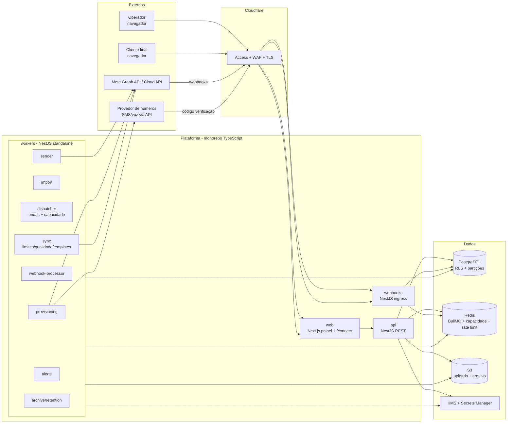
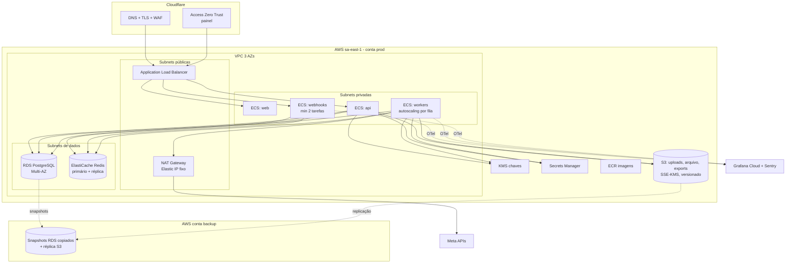
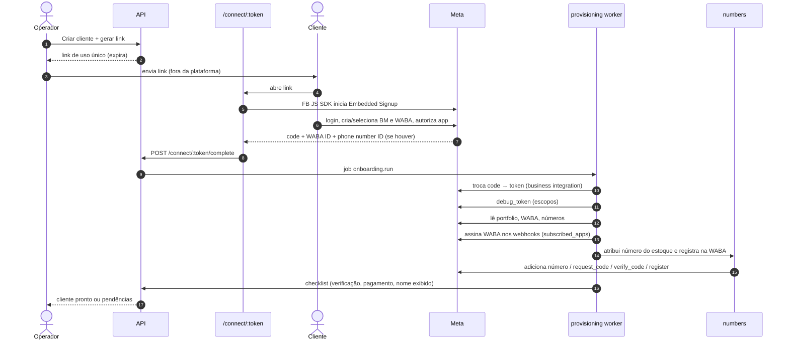
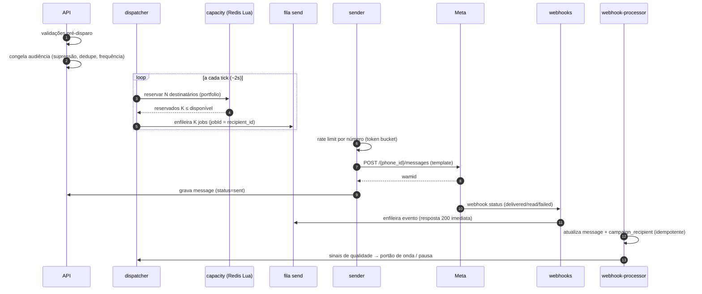

# 02 — Documento de Arquitetura

> Status: **aguardando aprovação** · Princípio guia (D-10): **simplicidade operacional para 1 desenvolvedor**, escalável por patamares (D-06).

## 1. Decisões de stack (com comparação)

### 1.1 Backend: **NestJS (adapter Fastify) + TypeScript**

| Critério | NestJS | Fastify puro |
|---|---|---|
| Estrutura modular (Provisioning, Messaging, Capacity…) | ✅ módulos, DI, guards nativos | ⚠️ você constrói a estrutura |
| Guards de tenant/RBAC, interceptors de auditoria | ✅ padrão do framework | Manual |
| Performance | Boa (com adapter Fastify) | Ótima |
| Integração BullMQ, OpenTelemetry, validação | ✅ pacotes oficiais/maduros | ✅ plugins |
| Curva para 1 dev manter por anos | Previsível, convenções fortes | Mais liberdade, mais decisões |

**Escolha:** NestJS com adapter Fastify — estrutura de NestJS com o desempenho de Fastify. O gargalo real é a Meta (limites/throughput), não o framework.

### 1.2 Acesso a dados: **Drizzle ORM + SQL explícito**
Prisma lida mal com particionamento nativo, RLS e SQL avançado (Lua/ZSET ficam no Redis, mas partições e políticas ficam no Postgres). Drizzle é SQL-first, com migrations em SQL revisável. Kysely seria a alternativa equivalente.

### 1.3 Filas: **BullMQ (Redis)** — RabbitMQ não se justifica

| Critério | BullMQ | RabbitMQ |
|---|---|---|
| Operação | Usa o Redis que já existe | Mais um cluster para operar |
| Jobs atrasados, retries com backoff, dedupe por jobId, rate limit | ✅ nativo | Plugins/código próprio |
| Volume do patamar Lançamento (~1M/dia ≈ 12 msg/s médio, picos ~300/s) | Folgado | Folgado |
| Painel | Bull Board | Management UI |

**Escolha:** BullMQ. Reavaliar apenas acima do patamar Crescimento se houver necessidade de roteamento complexo.

> **Implementado no S5 (VPS, MVP):** a fila de envio também é o próprio Postgres, como webhooks e importações — tabela
> `campaign_dispatch` (campanhas em andamento, lease) + `campaign_recipients` (estado por destinatário, claim com
> `FOR UPDATE SKIP LOCKED`). Capacidade de 24 h em `capacity_usage` (uma linha por telefone e portfolio) com
> `pg_advisory_xact_lock` por portfolio no lugar do script Lua; limite de pares (6 s) pela mesma tabela. Ritmo por número:
> `CAMPAIGN_RATE_PER_TICK` envios por ciclo de 1 s (padrão 40, abaixo dos 80/s da Meta). Sem Redis no caminho crítico;
> BullMQ volta a ser avaliado se um único processo de API deixar de dar conta.

**Isolamento por cliente (fairness):** em vez de uma fila por cliente (milhares de filas = overhead), usamos um **agendador (Dispatcher)** que libera lotes por campanha em *round-robin* ponderado, respeitando a capacidade de cada portfolio; os workers de envio consomem uma fila compartilhada com rate limit por número. Efeito: um cliente com 2.000 envios não bloqueia outro com 250. (Alternativa paga: BullMQ Pro "groups".)

### 1.4 Frontend: **Next.js (App Router) + React + Tailwind + shadcn/ui**
- TanStack Table (tabelas avançadas, filtros), TanStack Query, Recharts (gráficos), dark mode nativo.
- O painel é interno; a única página pública é `/connect/:token` (Embedded Signup).

### 1.5 Banco e cache
- **PostgreSQL 16** gerenciado (RDS): fonte da verdade, RLS, particionamento declarativo.
- **Redis 7** gerenciado (ElastiCache): filas BullMQ, rate limiters, janela de capacidade de 24h. **Não** é fonte da verdade — tudo é reconstruível a partir do Postgres.

### 1.6 Nuvem: **AWS sa-east-1 (São Paulo)**

| Critério | AWS | GCP | PaaS (Render/Railway/Fly) |
|---|---|---|---|
| Região Brasil | ✅ sa-east-1 | ✅ southamerica-east1 | ⚠️ limitada/inexistente |
| Workers de longa duração | ✅ ECS Fargate | ✅ Cloud Run (worker pools) / GKE | ✅ |
| IP de saída estável | ✅ NAT Gateway + Elastic IP | ✅ Cloud NAT | ⚠️ varia |
| KMS + Secrets + Backups cross-account | ✅ maduro | ✅ | ⚠️ |
| Custo | Médio (sa-east-1 é mais cara) | Médio | Baixo no início, caro em escala |

**Escolha:** AWS com **ECS Fargate** (sem servidores, sem Kubernetes), RDS, ElastiCache, S3, KMS, Secrets Manager. Infra como código em **Terraform/OpenTofu**. GCP é uma alternativa equivalente; PaaS foi descartado por região e controle de rede.

### 1.7 Borda, segurança e observabilidade
- **Cloudflare:** DNS, TLS, WAF, rate limiting, **Cloudflare Access** na frente do painel (exceto `/connect/*` e `/webhooks/*`).
- **OpenTelemetry** → **Grafana Cloud** (Prometheus/Mimir, Loki, Tempo, Alerting). **Sentry** para erros. Bull Board para filas.
- Alertas para o operador: **Telegram + e-mail**.

### 1.8 Kubernetes?
**Não no início.** Justifica-se apenas no patamar Grande escala se ECS deixar de atender (ex.: necessidade de autoscaling por métricas customizadas complexas ou multi-região ativa).

## 2. Visão de componentes



### 2.1 Módulos (bounded contexts no monólito)

| Módulo | Responsabilidade | Fases |
|---|---|---|
| `auth` | login, TOTP, sessões, RBAC | 4 |
| `audit` | interceptor de auditoria, consulta | 4 |
| `tenants` | clientes, configurações, exclusão | 4 |
| `meta-client` (pacote) | cliente HTTP tipado da Graph API, mapeamento de erros, `appsecret_proof`, versão configurável | 5 |
| `provisioning` | links de conexão, Embedded Signup, parceria, máquina de estados de onboarding | 6 |
| `numbers` | provedores, estoque, atribuição, verificação, quarentena | 6 |
| `accounts` | portfolios, WABAs, números, saúde, sincronização | 7 |
| `contacts` | importação, normalização, listas, supressão, consentimento | 8 |
| `templates` | biblioteca, aplicação em lote, status | 8 |
| `messaging` | campanhas, ondas, envio, status, opt-out | 8 |
| `capacity` | limites, janela de 24h, reservas | 9 |
| `costs` | preços, custo por mensagem/cliente, tetos | 9 |
| `alerts` | regras, deduplicação, notificação | 7/12 |
| `dashboard` | agregações e KPIs | 10 |

### 2.2 Estrutura do repositório (proposta)

```
apps/
  web/            Next.js (painel + /connect)
  api/            NestJS: entrypoints api.ts | webhooks.ts | worker.ts
packages/
  db/             schema Drizzle, migrations SQL, seeds
  meta-client/    cliente Graph API + catálogo de erros
  shared/         tipos, schemas zod, utilitários (E.164, hashing)
  config/         eslint, tsconfig
infra/
  terraform/      módulos: network, ecs, rds, redis, s3, kms, cloudflare
docs/
```

Uma imagem Docker do `api`, três *entrypoints* (api, webhooks, worker) — deploys independentes, código único.

## 3. Diagrama de infraestrutura



**Ambientes:** `dev` (docker-compose local: Postgres, Redis, MinIO, **meta-sim**), `staging` (conta AWS separada, dimensionamento mínimo, app Meta de teste), `prod` (conta AWS própria). Contas separadas via AWS Organizations.

**IP estável:** todo tráfego de saída (Meta, provedor de números) sai pelo Elastic IP do NAT Gateway — previsível para allowlists e auditoria. *Não* há rotação de IP (item 11 do prompt).

## 4. Fluxos principais

### 4.1 Onboarding via Embedded Signup


⚠️ *A validar:* formato exato dos eventos retornados pelo SDK, tipo de token resultante e se o número do operador é adicionado dentro do fluxo ou depois via API.

### 4.2 Campanha: do disparo ao status



### 4.3 Webhooks
1. `GET /webhooks/meta` responde o desafio de verificação (`hub.verify_token`).
2. `POST /webhooks/meta` valida `X-Hub-Signature-256` (HMAC SHA-256 com app secret, sobre o **corpo bruto**), grava o evento (`webhook_events`, um por `change`) e responde 200. A Meta recomenda latência mediana **≤ 250 ms**, reentrega por até 7 dias e manda lotes de até 1000 eventos.
   **Decisão (S2):** a fila de webhooks é a própria tabela `webhook_events` (claim com `FOR UPDATE SKIP LOCKED` + lease), não BullMQ: durável na mesma transação do recebimento e sem Redis no caminho crítico. BullMQ continua previsto para envios (S3).
3. `webhook-processor` roteia por campo (lista validada em `docs/04-endpoints.md` §2.1) com deduplicação por chave (hash de objeto + entry + campo + valor; em S3, `wamid + status`). Falha → backoff exponencial até 60 min; após 8 tentativas → `dead`.
4. Job de reconciliação periódica cobre eventos perdidos (consulta estado na API).

## 5. Capacity Manager — algoritmo

**Fonte do limite:** campo `whatsapp_business_manager_messaging_limit` do portfolio (validado; `messaging_limit_tier` está depreciado) e webhook `business_capability_update`, sincronizado a cada 15 min e ao receber webhooks de capacidade/conta.

**Janela de 24h por portfolio (Redis):**
- `ZSET cap:{portfolio}:window` → membro = `hash(telefone)`, score = timestamp do primeiro envio de template na janela.
- `cap:{portfolio}:limit` → limite efetivo = `tier × margem` (padrão 90%).

**Reserva atômica (script Lua):**
```
remove membros com score < agora − 24h
para cada destinatário do lote:
  se já está na janela → reserva sem consumir slot (destinatário não é "novo")
  senão se ZCARD < limite → ZADD (consome slot)
  senão → para; retorna reservados
```
- Reservas não confirmadas (envio falhou antes de a Meta aceitar) são liberadas.
- Contagem é **conservadora**: conta todo template enviado pela plataforma. Envios feitos fora da plataforma pelo cliente não são vistos → a margem cobre a diferença, e erros de limite da Meta pausam a campanha.
- Reconstrução: se o Redis cair, a janela é recalculada a partir de `messages` (últimas 24h).

**Throughput (separado do limite):** 80 msg/s por número por padrão, até 1.000 msg/s se elegível; números em coexistência: 20 msg/s (fonte: documentação Meta via busca — ⚠️ a validar). Lido do campo `throughput` do número. Token bucket por número no Redis + limite de pares (mesmo destinatário em intervalo curto).

**Previsão:** `tempo restante ≈ pendentes ÷ min(capacidade disponível/24h, throughput)` exibido na campanha.

## 6. Messaging Engine — regras

### 6.1 Ondas e portões
- Política padrão (configurável por cliente): onda 1 = 5% (mín. 20, máx. 200) → aguarda 15 min ou 90% dos status → avalia portão → próxima onda = 2× anterior.
- **Portão reprova** se: falhas permanentes > 10%, erros de ecossistema/spam acima do limiar, webhook de qualidade negativa, template pausado. Resultado: campanha `paused` com motivo + alerta.

### 6.2 Idempotência e retries
- `campaign_recipients (campaign_id, contact_id)` é único; jobId BullMQ = `recipient_id`; o sender verifica estado antes de chamar a Meta.
- **Timeouts ambíguos** (não sabemos se a Meta aceitou): **não reenviar automaticamente** — status `uncertain`, reconciliado por webhook; o operador decide reenvio. Evita mensagens duplicadas.
- Retry com backoff exponencial + jitter (máx. 5 tentativas) para erros transitórios (throughput, 5xx antes de aceite, rede).
- Esgotadas as tentativas → DLQ (`failed` no BullMQ + registro), com tela de inspeção e reenvio.

### 6.3 Catálogo de erros (validado: `docs/10-meta-referencia.md` §6; implementado em `classifyMetaError`)

| Situação | Ação |
|---|---|
| Throughput excedido (ex.: 130429) | Backoff e reduz taxa do número |
| Limite de pares (ex.: 131056) | Reagenda o destinatário |
| Limite de mensagens de marketing por usuário / ecossistema (ex.: 131049) | Não reenviar no mesmo dia; marca `skipped` |
| Limite de spam (ex.: 131048) | **Pausa campanha** + alerta |
| Número inválido/não entregável (ex.: 131026) | Falha permanente; opcionalmente marca contato como inválido |
| Problema de pagamento (ex.: 131042) | **Pausa todas as campanhas do cliente** + alerta crítico |
| Template inexistente/pausado (132xxx) | Pausa campanha + sincroniza template |
| Token inválido/expirado (190) | Marca conexão `broken`, pausa cliente, alerta |
| Conta bloqueada por política (ex.: 368, 131031) | Pausa cliente + alerta crítico + procedimento de revisão |
| Opt-out de marketing (131050) | **Suprime o contato**; nunca reenviar |
| Restrição por país / classificação de template (130497, 131064) | Pausa campanha |
| Pacing do portfolio (135000, 132015) | Pausa campanha (portão de qualidade) |
| Rate limit da API / manutenção (4, 80007, 131057) | Transitório: repetir mais devagar |
| Regra geral | Lógica por `code` + `error_data.details`; `is_transient: true` = pode repetir; `error_subcode` depreciado |

### 6.4 Opt-out
- Mensagem recebida com palavra-chave normalizada (`sair`, `parar`, `pare`, `stop`, `cancelar`, `descadastrar`, `não quero`…) ou payload do botão de opt-out → insere em `suppressions` e cancela pendentes do contato no cliente. Meta: < 60 s.

## 7. Segurança

| Camada | Controle |
|---|---|
| Acesso ao painel | Cloudflare Access + login com argon2id + TOTP obrigatório; cookies `HttpOnly`, `Secure`, `SameSite=Strict`; expiração por inatividade (30 min) e absoluta (12 h). |
| Autorização | RBAC por papel; guards por rota; verificação de tenant em toda consulta. |
| Isolamento | `tenant_id` em todas as tabelas de negócio + **Row-Level Security** no Postgres (`SET LOCAL app.tenant_id` por transação). Dashboards agregados usam papel de leitura dedicado. |
| Tokens Meta | Envelope encryption: chave de dados por cliente cifrada pela KMS; decriptação apenas em memória nos workers; redação automática em logs; `appsecret_proof` nas chamadas. |
| Webhooks | Assinatura `X-Hub-Signature-256` obrigatória; rate limit; payload bruto retido para auditoria. |
| Página `/connect` | Token de uso único (hash armazenado), expiração, rate limit, sem dados sensíveis expostos. |
| Segredos | AWS Secrets Manager; nada em repositório; rotação documentada. |
| Dados em repouso/trânsito | RDS/S3/Redis cifrados (KMS); TLS 1.2+ em tudo. |
| Auditoria | `audit_logs` append-only (sem UPDATE/DELETE para o papel da aplicação). |
| Cadeia de suprimentos | Renovate/Dependabot, CodeQL, Trivy nas imagens, lockfile obrigatório. |
| Cartão | **Nenhum dado de cartão na plataforma** (D-09). |
| LGPD | DPA com clientes, exclusão por cliente, minimização em logs (telefones mascarados), registro de operações de tratamento. |

## 8. Observabilidade

- **Logs** estruturados JSON (pino) com `trace_id`, `tenant_id`, `campaign_id`; telefones mascarados.
- **Métricas** (OTel → Prometheus): `messages_sent_total{status}`, `meta_api_errors_total{code}`, `meta_api_latency`, `queue_depth{queue}`, `queue_oldest_job_age`, `capacity_available{portfolio}`, `webhook_ingest_lag_seconds`, `campaigns_paused_total{reason}`, `cost_usd_total{tenant}`.
- **Tracing** distribuído: API → fila → worker → Meta (propagação de contexto nos jobs BullMQ).
- **Alertas** (Grafana → Telegram/e-mail): fila parada > 5 min, lag de webhook > 5 min, taxa de erro Meta > 5%, token inválido, falha de pagamento, qualidade em queda, worker sem heartbeat, CPU/armazenamento do banco, backups falhando.
- **Painéis:** Operação (filas/workers), Meta (erros/latência), Negócio (envios/entregas/custo), Saúde por cliente.

## 9. Escalabilidade por patamar

| Patamar | Mudanças |
|---|---|
| Lançamento | 2 api, 2 webhooks, 2–4 workers; RDS `db.t4g.medium` Multi-AZ; Redis pequeno com réplica. |
| Crescimento | Autoscaling de workers por profundidade de fila; RDS maior + réplica de leitura para dashboards; arquivamento automático de partições antigas. |
| Grande escala | Redis cluster; separação de workers por tipo em serviços dedicados; avaliar sharding por tenant ou Citus; avaliar Kubernetes. |

Toda afirmação de capacidade depende de teste de carga (`08-plano-de-testes.md`).

## 10. Recuperação de desastres

- **Banco:** PITR (RPO ≤ 5 min), snapshots diários copiados para conta de backup; restauração testada mensalmente.
- **Redis:** descartável; reconstrução da janela de capacidade e reenfileiramento a partir do Postgres (`campaign_recipients` pendentes).
- **S3:** versionamento + replicação para conta de backup.
- **Infra:** recriação completa via Terraform; runbook de *region outage* (subir em `us-east-1` a partir dos backups — ⚠️ implica transferência internacional de dados, prevista no DPA).
- **RTO alvo:** 4 h.

## 11. Modo BSP (futuro, D-01)
Quando credenciado como Solution Partner: compartilhamento da linha de crédito com a WABA no onboarding (endpoint de *credit sharing* — ⚠️ a validar) substitui a etapa "cartão configurado na WABA". O restante da arquitetura não muda; `costs` passa a usar faturas da linha de crédito como fonte.
