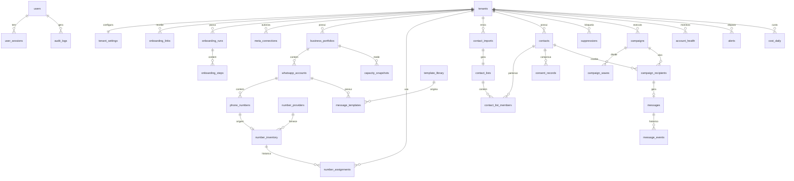

# 03 — Modelo de Dados

> Status: **aguardando aprovação** · PostgreSQL 16 · Decisões: D-04, D-09, D-13, D-14

## 1. Ajustes em relação ao prompt original

| Entidade original | Situação | Motivo |
|---|---|---|
| `organizations` | Removida | Plataforma de um único operador (D-04); `tenants` = clientes. |
| `users` | Mantida (operadores) | RBAC mínimo. |
| `oauth_connections` | Renomeada `meta_connections` | Tokens de Embedded Signup e de system user. |
| `business_accounts` | Renomeada `business_portfolios` | Terminologia atual da Meta. |
| `account_capacity` | Mantida como `capacity_snapshots` | Estado vivo fica no Redis; histórico no Postgres. |
| `subscriptions`, `billing_events` | **Removidas** | Cobrança fora da plataforma (D-09). |
| — | **Novas:** `number_providers`, `number_inventory`, `number_assignments`, `onboarding_links`, `onboarding_runs`, `onboarding_steps`, `contact_imports`, `contact_lists`, `contact_list_members`, `suppressions`, `template_library`, `campaign_waves`, `alerts`, `pricing_rates`, `cost_daily`, `tenant_settings`, `user_sessions` | Requisitos levantados no discovery. |

## 2. Diagrama entidade-relacionamento



## 3. Convenções

- PK `uuid` (v7, ordenável por tempo) — exceto tabelas de altíssimo volume com `bigint identity`.
- Toda tabela de negócio tem `tenant_id uuid not null` + política RLS.
- `created_at`/`updated_at timestamptz not null default now()`.
- Enums como tipos Postgres (`create type`), versionados por migration.
- Segredos: colunas `bytea` com sufixo `_enc` + `key_id` (envelope encryption).
- Telefones: `phone_e164 text` (ex.: `+5511987654321`) + `phone_hash bytea` (HMAC-SHA256 com chave por cliente) para supressão e buscas.

## 4. Tabelas (DDL resumida)

> DDL ilustrativa, agrupada por domínio para leitura. A ordem real de criação (ex.: `number_inventory` antes de `phone_numbers`), as políticas RLS e os grants ficam nas migrations.

### 4.1 Operadores, sessões, auditoria

```sql
create type user_role as enum ('owner','operator','viewer');

create table users (
  id uuid primary key,
  email citext not null unique,
  password_hash text not null,              -- argon2id
  totp_secret_enc bytea not null,
  key_id text not null,
  role user_role not null default 'operator',
  status text not null default 'active',    -- active | disabled
  last_login_at timestamptz,
  created_at timestamptz not null default now()
);

create table user_sessions (
  id uuid primary key,
  user_id uuid not null references users(id) on delete cascade,
  token_hash bytea not null unique,
  ip inet, user_agent text,
  expires_at timestamptz not null,
  revoked_at timestamptz,
  created_at timestamptz not null default now()
);
create index on user_sessions (user_id) where revoked_at is null;

create table audit_logs (
  id bigint generated always as identity,
  user_id uuid references users(id),
  tenant_id uuid,
  action text not null,                     -- ex.: campaign.start
  entity_type text not null, entity_id text,
  before jsonb, after jsonb,
  ip inet, user_agent text,
  created_at timestamptz not null default now(),
  primary key (id, created_at)
) partition by range (created_at);
create index on audit_logs (tenant_id, created_at desc);
-- papel da aplicação: GRANT INSERT, SELECT apenas (append-only)
```

### 4.2 Clientes e onboarding

```sql
create type tenant_status as enum ('onboarding','active','paused','offboarded');

create table tenants (
  id uuid primary key,
  name text not null,
  legal_name text, cnpj char(14) unique,
  contact_name text, contact_phone text, contact_email citext,
  status tenant_status not null default 'onboarding',
  notes text,
  created_at timestamptz not null default now(),
  offboarded_at timestamptz
);

create table tenant_settings (
  tenant_id uuid primary key references tenants(id) on delete cascade,
  monthly_cost_cap_usd numeric(12,2),        -- null = sem teto
  capacity_safety_pct smallint not null default 90 check (capacity_safety_pct between 50 and 100),
  wave_policy jsonb not null default '{"first_pct":5,"min":20,"max":200,"growth":2,"gate_minutes":15}',
  max_msgs_per_contact_24h smallint not null default 1,
  contact_button_url text,                   -- botão "falar com a loja"
  auto_reply_enabled boolean not null default false  -- opção B futura (D-07)
);

create table onboarding_links (
  id uuid primary key,
  tenant_id uuid not null references tenants(id) on delete cascade,
  token_hash bytea not null unique,
  expires_at timestamptz not null,
  used_at timestamptz,
  created_by uuid references users(id),
  created_at timestamptz not null default now()
);

create type onboarding_method as enum ('embedded_signup','partner_share','manual');
create type run_status as enum ('pending','running','blocked','succeeded','failed');

create table onboarding_runs (
  id uuid primary key,
  tenant_id uuid not null references tenants(id) on delete cascade,
  method onboarding_method not null,
  status run_status not null default 'pending',
  blocked_reason text,
  started_at timestamptz, finished_at timestamptz,
  created_at timestamptz not null default now()
);

create table onboarding_steps (
  id uuid primary key,
  run_id uuid not null references onboarding_runs(id) on delete cascade,
  tenant_id uuid not null,
  step text not null,                        -- exchange_token, fetch_assets, subscribe_webhooks, assign_number, verify_number, register_number, check_payment, check_verification, apply_templates
  status run_status not null,
  attempt smallint not null default 1,
  payload jsonb, error jsonb,
  created_at timestamptz not null default now()
);
create index on onboarding_steps (run_id, created_at);
```

### 4.3 Ativos Meta

```sql
create type connection_status as enum ('active','broken','revoked');

create table meta_connections (
  id uuid primary key,
  tenant_id uuid not null references tenants(id) on delete cascade,
  kind text not null,                        -- business_integration | system_user
  access_token_enc bytea not null,
  key_id text not null,
  scopes text[] not null,
  meta_app_scoped_user_id text,
  expires_at timestamptz,                    -- null = não expira
  status connection_status not null default 'active',
  last_validated_at timestamptz,
  created_at timestamptz not null default now()
);
create index on meta_connections (tenant_id) where status = 'active';

create table business_portfolios (
  id uuid primary key,
  tenant_id uuid not null references tenants(id) on delete cascade,
  meta_business_id text not null unique,
  name text,
  verification_status text,                  -- verified | pending | not_verified ...
  messaging_limit_tier text,                 -- TIER_250 | TIER_2K | ... (⚠️ valores a validar)
  messaging_limit_value integer,             -- null = ilimitado
  limit_synced_at timestamptz,
  created_at timestamptz not null default now()
);

create table whatsapp_accounts (
  id uuid primary key,
  tenant_id uuid not null references tenants(id) on delete cascade,
  portfolio_id uuid not null references business_portfolios(id),
  meta_waba_id text not null unique,
  name text, currency char(3), timezone_id text,
  account_review_status text,
  payment_status text,                       -- ok | missing | failed (derivado de sinais/erros)
  webhooks_subscribed boolean not null default false,
  status text not null default 'active',     -- active | restricted | disabled
  restriction_info jsonb,
  synced_at timestamptz,
  created_at timestamptz not null default now()
);

create table phone_numbers (
  id uuid primary key,
  tenant_id uuid not null references tenants(id) on delete cascade,
  waba_id uuid not null references whatsapp_accounts(id),
  meta_phone_number_id text not null unique,
  phone_e164 text not null,
  verified_name text,
  name_status text,                          -- APPROVED | PENDING | DECLINED ...
  quality_rating text,                       -- GREEN | YELLOW | RED | UNKNOWN
  throughput_level text,
  code_verification_status text,
  status text not null default 'pending',    -- pending | connected | flagged | restricted | disconnected
  inventory_id uuid references number_inventory(id),
  registered_at timestamptz, synced_at timestamptz,
  created_at timestamptz not null default now()
);
create unique index phone_numbers_active_e164 on phone_numbers (phone_e164) where status <> 'disconnected';
```

### 4.4 Estoque de números (D-13)

```sql
create table number_providers (
  id uuid primary key,
  name text not null,
  api_kind text not null,                    -- ex.: sms_webhook | voice_transcription | manual
  config_enc bytea, key_id text,
  created_at timestamptz not null default now()
);

create type inventory_status as enum ('available','verifying','active','quarantine','cancelled');

create table number_inventory (
  id uuid primary key,
  provider_id uuid not null references number_providers(id),
  phone_e164 text not null unique,
  monthly_cost_brl numeric(10,2) not null,
  status inventory_status not null default 'available',
  quarantine_until timestamptz,
  acquired_at timestamptz not null default now(),
  cancelled_at timestamptz
);
create index on number_inventory (status);

create table number_assignments (
  id uuid primary key,
  inventory_id uuid not null references number_inventory(id),
  tenant_id uuid not null references tenants(id),
  phone_number_id uuid references phone_numbers(id),
  assigned_at timestamptz not null default now(),
  released_at timestamptz,
  release_reason text
);
-- regra D-13: no máximo uma atribuição ativa por número
create unique index number_assignments_one_active on number_assignments (inventory_id) where released_at is null;
```
Regra de aplicação: reatribuição só se `status = 'available'` (após `quarantine_until`). Não existe operação de "mover número entre clientes ativos".

### 4.5 Contatos, consentimento e supressão

```sql
create table contact_imports (
  id uuid primary key,
  tenant_id uuid not null references tenants(id) on delete cascade,
  file_key text not null,                    -- S3
  original_filename text not null,
  status text not null,                      -- uploaded | parsing | preview | confirmed | failed
  row_count int, valid_count int, invalid_count int, duplicate_count int, suppressed_count int,
  origin_declaration text not null,          -- customers | signup | leads | other
  legal_basis text not null,                 -- consentimento | legítimo interesse | execução de contrato
  declaration_notes text,
  declared_by uuid not null references users(id),
  declared_at timestamptz not null,
  created_at timestamptz not null default now()
);

create table contacts (
  id uuid primary key,
  tenant_id uuid not null references tenants(id) on delete cascade,
  phone_e164 text not null,
  phone_hash bytea not null,
  name text,
  attributes jsonb not null default '{}',    -- variáveis do template
  first_import_id uuid references contact_imports(id),
  invalid_at timestamptz,                    -- marcado inválido após falha permanente
  created_at timestamptz not null default now(),
  unique (tenant_id, phone_e164)
);
create index on contacts (tenant_id, phone_hash);

create table contact_lists (
  id uuid primary key,
  tenant_id uuid not null references tenants(id) on delete cascade,
  import_id uuid unique references contact_imports(id),
  name text not null,
  size int not null default 0,
  created_at timestamptz not null default now()
);

create table contact_list_members (
  list_id uuid not null references contact_lists(id) on delete cascade,
  contact_id uuid not null references contacts(id) on delete cascade,
  tenant_id uuid not null,
  primary key (list_id, contact_id)
);

create table consent_records (
  id uuid primary key,
  tenant_id uuid not null references tenants(id) on delete cascade,
  contact_id uuid not null references contacts(id) on delete cascade,
  basis text not null,
  source text not null,                      -- import_declaration | opt_in_reply | manual
  import_id uuid references contact_imports(id),
  evidence jsonb,
  recorded_at timestamptz not null default now()
);
create index on consent_records (tenant_id, contact_id);

create table suppressions (
  tenant_id uuid not null references tenants(id) on delete cascade,
  phone_hash bytea not null,
  reason text not null,                      -- opt_out_keyword | opt_out_button | manual | complaint | invalid
  source_message_id uuid,
  created_at timestamptz not null default now(),
  primary key (tenant_id, phone_hash)
);
```

### 4.6 Templates

```sql
create table template_library (
  id uuid primary key,
  name text not null,
  objective text not null,                   -- promocao | retomada | lancamento | lembrete ...
  language text not null default 'pt_BR',
  category_hint text not null,               -- MARKETING | UTILITY
  components jsonb not null,                 -- header/body/footer/buttons com {{variáveis}}
  variables jsonb not null,                  -- definição e exemplos (exigidos na submissão)
  version int not null default 1,
  status text not null default 'active',
  created_by uuid references users(id),
  created_at timestamptz not null default now()
);

create table message_templates (
  id uuid primary key,
  tenant_id uuid not null references tenants(id) on delete cascade,
  waba_id uuid not null references whatsapp_accounts(id),
  library_template_id uuid references template_library(id),
  library_version int,
  meta_template_id text,
  name text not null,
  language text not null,
  category text,                             -- categoria atual (pode ser reclassificada)
  submitted_category text,
  status text not null,                      -- PENDING | APPROVED | REJECTED | PAUSED | DISABLED ...
  quality_score text,
  rejection_reason text,
  components jsonb not null,
  last_status_at timestamptz,
  created_at timestamptz not null default now(),
  unique (waba_id, name, language)
);
create index on message_templates (tenant_id, status);
```

### 4.7 Campanhas e mensagens (alto volume)

```sql
create type campaign_status as enum ('draft','scheduled','running','paused','completed','cancelled','failed');

create table campaigns (
  id uuid primary key,
  tenant_id uuid not null references tenants(id) on delete cascade,
  phone_number_id uuid not null references phone_numbers(id),
  template_id uuid not null references message_templates(id),
  list_id uuid not null references contact_lists(id),
  name text not null,
  status campaign_status not null default 'draft',
  pause_reason text,
  wave_policy jsonb not null,
  audience_size int, estimated_cost_usd numeric(12,4),
  scheduled_at timestamptz, started_at timestamptz, completed_at timestamptz,
  created_by uuid references users(id),
  created_at timestamptz not null default now()
);
create index on campaigns (tenant_id, status);
create index on campaigns (status) where status in ('scheduled','running');

create table campaign_waves (
  id uuid primary key,
  campaign_id uuid not null references campaigns(id) on delete cascade,
  tenant_id uuid not null,
  seq smallint not null,
  planned_size int not null,
  sent int not null default 0, delivered int not null default 0, failed int not null default 0,
  gate_status text not null default 'pending', -- pending | passed | failed
  gate_details jsonb,
  started_at timestamptz, finished_at timestamptz,
  unique (campaign_id, seq)
);

create type recipient_status as enum ('pending','reserved','queued','sent','delivered','read','failed','uncertain','skipped_suppressed','skipped_frequency','skipped_ecosystem','cancelled');

create table campaign_recipients (
  id bigint generated always as identity,
  campaign_id uuid not null,
  tenant_id uuid not null,
  contact_id uuid not null,
  status recipient_status not null default 'pending',
  wave_seq smallint,
  message_id uuid,
  error_code text,
  created_at timestamptz not null default now(),
  updated_at timestamptz not null default now(),
  primary key (id, created_at),
  unique (campaign_id, contact_id, created_at)
) partition by range (created_at);
create index on campaign_recipients (campaign_id, status);

create table messages (
  id uuid not null,                          -- uuid v7
  tenant_id uuid not null,
  campaign_id uuid,
  recipient_id bigint,
  phone_number_id uuid not null,
  contact_id uuid,
  direction text not null,                   -- outbound | inbound
  wamid text,
  template_id uuid,
  type text not null,                        -- template | text | button | interactive ...
  body jsonb,                                -- inbound: conteúdo recebido
  status text not null,                      -- accepted | sent | delivered | read | failed
  pricing_category text, billable boolean,
  cost_usd numeric(10,5),
  error_code text, error_title text,
  sent_at timestamptz, delivered_at timestamptz, read_at timestamptz, failed_at timestamptz,
  created_at timestamptz not null default now(),
  primary key (id, created_at)
) partition by range (created_at);
create index on messages (tenant_id, created_at desc);
create index on messages (campaign_id) where campaign_id is not null;

-- índice global wamid → mensagem (unique em tabela particionada exige a chave de partição)
create table message_wamid_index (
  wamid text primary key,
  message_id uuid not null,
  message_created_at timestamptz not null,
  tenant_id uuid not null
);

create table message_events (
  id bigint generated always as identity,
  tenant_id uuid not null,
  message_id uuid not null,
  wamid text not null,
  event_type text not null,                  -- status | error | pricing
  status text,
  error_code text,
  payload jsonb not null,
  occurred_at timestamptz not null,
  received_at timestamptz not null default now(),
  primary key (id, received_at),
  unique (wamid, event_type, status, received_at)
) partition by range (received_at);
create index on message_events (message_id);
```

### 4.8 Capacidade, saúde, alertas, webhooks

```sql
create table capacity_snapshots (
  id bigint generated always as identity primary key,
  portfolio_id uuid not null references business_portfolios(id) on delete cascade,
  tenant_id uuid not null,
  limit_tier text, limit_value int,
  used_24h int not null, reserved int not null, available int not null,
  taken_at timestamptz not null default now()
);
create index on capacity_snapshots (portfolio_id, taken_at desc);

create table account_health (
  id bigint generated always as identity primary key,
  tenant_id uuid not null references tenants(id) on delete cascade,
  entity_type text not null,                 -- portfolio | waba | phone_number | template
  entity_id uuid not null,
  quality_rating text, status text,
  signal jsonb not null,                     -- evento de origem
  observed_at timestamptz not null default now()
);
create index on account_health (entity_type, entity_id, observed_at desc);

create table alerts (
  id uuid primary key,
  tenant_id uuid references tenants(id) on delete cascade,
  severity text not null,                    -- info | warning | critical
  type text not null,                        -- quality_drop | payment_failed | token_broken | template_paused | webhook_lag ...
  entity_type text, entity_id uuid,
  message text not null,
  status text not null default 'open',       -- open | acknowledged | resolved
  dedupe_key text not null,
  opened_at timestamptz not null default now(),
  resolved_at timestamptz
);
create unique index alerts_open_dedupe on alerts (dedupe_key) where status <> 'resolved';

create table webhook_events (
  id bigint generated always as identity,
  received_at timestamptz not null default now(),
  source text not null,                      -- meta | number_provider
  signature_valid boolean not null,
  field text,
  meta_waba_id text,
  dedupe_key text not null,
  payload jsonb not null,
  status text not null default 'queued',     -- queued | processed | failed | ignored
  processed_at timestamptz, error text,
  primary key (id, received_at)
) partition by range (received_at);
create index on webhook_events (status, received_at) where status in ('queued','failed');
```

### 4.9 Custos (D-09)

```sql
create table pricing_rates (
  id uuid primary key,
  country char(2) not null,                  -- BR
  category text not null,                    -- MARKETING | UTILITY | AUTHENTICATION | SERVICE
  currency char(3) not null,                 -- USD | BRL
  unit_price numeric(10,5) not null,
  effective_from date not null,
  effective_to date,
  source_note text,
  exclude using gist (country with =, category with =, currency with =, daterange(effective_from, effective_to) with &&)
);

create table cost_daily (
  tenant_id uuid not null references tenants(id) on delete cascade,
  day date not null,
  category text not null,
  messages int not null default 0,
  cost_usd numeric(12,4) not null default 0,
  number_cost_brl numeric(10,2) not null default 0,
  primary key (tenant_id, day, category)
);
```

## 5. Row-Level Security

```sql
alter table contacts enable row level security;
create policy tenant_isolation on contacts
  using (tenant_id = current_setting('app.tenant_id')::uuid)
  with check (tenant_id = current_setting('app.tenant_id')::uuid);
-- repetido para todas as tabelas com tenant_id
```
- Workers e API abrem transação com `SET LOCAL app.tenant_id = '<uuid>'`. Uma consulta sem contexto **não retorna nada** (falha segura).
- Papel `app_reporting` (com `BYPASSRLS`, somente leitura) usado exclusivamente pelos endpoints de dashboard agregado.
- Testes automatizados garantem que nenhuma tabela com `tenant_id` fica sem política.

## 6. Particionamento

- Mensal por `created_at`/`received_at`: `messages`, `message_events`, `campaign_recipients`, `webhook_events`, `audit_logs`.
- Partições criadas com 3 meses de antecedência por **pg_partman** (ou job agendado próprio).
- Volume estimado no patamar Lançamento: ~30M mensagens/mês → partições mensais de ~10–20 GB (com índices) — gerenciável.

## 7. Retenção e arquivamento (D-14)

- **Nada é excluído automaticamente.** Exclusão só por ação do operador (cliente, campanha ou período), auditada.
- **Arquivamento quente → frio:** partições com mais de 6 meses (configurável) são exportadas para **Parquet no S3**, organizadas por `tenant_id=/ano=/mes=/`, e então removidas do banco. Consultas históricas via DuckDB/Athena (tela "histórico arquivado").
- A organização por `tenant_id` no arquivo permite **excluir um cliente inteiro**, inclusive do arquivo, atendendo à LGPD.
- `suppressions`, `audit_logs` e `consent_records` permanecem no banco.
- `webhook_events` bruto: arquivado após 30 dias (é volumoso e já foi processado).

## 8. Backup

| Item | Estratégia |
|---|---|
| RDS | Backups automáticos com PITR (retenção 35 dias) + snapshot diário copiado para **conta AWS de backup** (mesma região; cópia cross-region opcional) |
| S3 | Versionamento + Object Lock (modo governança) no bucket de arquivo + replicação para conta de backup |
| Teste | Restauração mensal automatizada em ambiente isolado, com verificação de contagens |
| Chaves | KMS com chaves multi-região/backup documentado; sem a chave, backups de tokens são inúteis (intencional) |

## 9. Migrações

- **Drizzle Kit** gera SQL; todo arquivo é revisado e versionado em `packages/db/migrations`.
- Executadas no pipeline de CI/CD como etapa anterior ao deploy (tarefa ECS dedicada), com lock.
- Padrão **expand/contract** para mudanças sem downtime (adiciona coluna → backfill → passa a usar → remove antiga em release posterior).
- Índices em tabelas grandes com `create index concurrently` (migração não transacional).
- Seeds apenas para dev/staging (dados fictícios; nunca dados reais de clientes).
