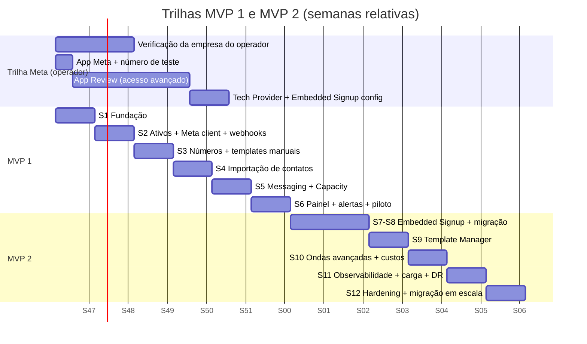

# 05 — Roadmap

> Status: **aguardando aprovação** · Equipe: 1 dev + Claude (D-10) · Prioridade: prazo (D-11)
> Estimativas assumem dedicação integral; serão recalibradas ao fim de cada semana.

## 1. Duas trilhas em paralelo

(Datas ilustrativas a partir da aprovação.)

### Trilha Meta — responsabilidade do operador, com meu guia passo a passo
| Passo | Critério de conclusão |
|---|---|
| T1. Verificar a empresa (CNPJ) no Business Manager | Status "verificada" |
| T2. Criar app (tipo Business) no Meta for Developers + produto WhatsApp | App ID, número de teste ativo |
| T3. Política de privacidade e termos publicados (exigidos no fluxo) | URLs públicas |
| T4. App Review: acesso avançado a `whatsapp_business_management`, `whatsapp_business_messaging` (+ `public_profile`) — ⚠️ lista a validar | Permissões aprovadas |
| T5. Concluir requisitos de Tech Provider e configurar Embedded Signup | `config_id` gerado, app em modo Live |

**Caminho crítico:** sem T4, a plataforma não envia pelas BMs dos clientes. T1–T3 começam **no dia 1**.

## 2. Mapeamento das 14 fases do prompt

| Fase | Onde entra |
|---|---|
| 1 Discovery | ✅ concluída |
| 2 Arquitetura e documentação | ✅ este pacote (após aprovação) |
| 3 Banco e infraestrutura | S1 (base) · S11 (completa) |
| 4 Autenticação e multi-tenancy | S1 |
| 5 Integração Meta | S2 (client + webhooks) · S7 (Embedded Signup) |
| 6 Provisioning Engine | S2–S3 (parceria/manual + números) · S7–S8 (Embedded Signup) |
| 7 Account Manager | S2 (sync) · S6 (painel) |
| 8 Messaging Engine | S4–S5 · S10 (ondas avançadas) |
| 9 Capacity Manager | S5 |
| 10 Dashboard administrativo | S6 (básico) · S10–S11 (completo) |
| 11 Dashboard dos clientes | ❌ removida (D-04); substituída por relatórios exportáveis (S10) |
| 12 Observabilidade e segurança | S1 (base) · S11 (completa) |
| 13 Testes de carga | S11 |
| 14 Deploy em produção | S6 (piloto) · S12 (escala) |

## 3. MVP 1 — semanas 1 a 6

**Objetivo:** atender o cliente urgente e um piloto de 5–10 clientes com disparo oficial, seguro e dentro do limite.

| Semana | Entregáveis | Critérios de conclusão |
|---|---|---|
| **S1 Fundação** | Monorepo (pnpm/Turborepo), CI (lint, testes, build, scan), docker-compose (Postgres, Redis, MinIO), schema v1 + migrations, RLS, auth com TOTP, RBAC, auditoria, Terraform base de staging | CI verde; login com TOTP; teste automatizado prova isolamento RLS; staging sobe via Terraform |
| **S2 Ativos + Meta** | `meta-client` tipado + catálogo de erros + **meta-sim**; cadastro de cliente; cadastro de ativos por parceria/manual; criptografia de tokens (KMS); webhooks (verificação, assinatura, ingestão, processor); sync de limites/qualidade | Webhook assinado processado ponta a ponta no staging com número de teste Meta; token nunca aparece em log (teste) |
| **S3 Números + templates** | Number Inventory (provedor manual), registro de número na WABA (request/verify/register), templates por cliente (criação manual, submissão, sync de status) | Número de teste registrado; template aprovado sincronizado via webhook |
| **S4 Contatos** | Upload CSV/XLSX/TXT, normalização E.164 (nono dígito), dedupe, supressão, declaração de origem, relatório de pré-visualização, listas | Arquivo de 1M linhas importado em < 10 min no staging; contato suprimido nunca entra na lista |
| **S5 Messaging + Capacity** | Campanhas, pré-validações, congelamento de audiência, dispatcher, reserva atômica de capacidade (Lua), sender com rate limit por número, retries/backoff, DLQ, status por webhook, opt-out automático, ondas simples, pausa automática | Testes provam: nunca excede `limite × margem`; idempotência (zero duplicadas em 10k envios com falhas injetadas); opt-out < 60 s |
| **S6 Painel + piloto** | Painel: clientes, ativos, campanhas, capacidade, alertas, filas; alertas Telegram/e-mail; observabilidade básica (logs, Sentry, métricas principais); deploy prod; runbook de incidentes | Piloto envia campanha real dentro do limite; alerta de qualidade testado; backup restaurado com sucesso uma vez |

**Fora do MVP 1:** Embedded Signup (clientes do piloto conectam por parceria), biblioteca de templates, custos detalhados, teste de carga completo.

**Ponte para o cliente urgente:** ver `07-riscos.md` R-02 — depende do App Review; alternativas documentadas.

## 4. MVP 2 — semanas 7 a 12

**Objetivo:** onboarding automatizado (100/dia) e migração gradual dos ~200 clientes.

| Semana | Entregáveis | Critérios de conclusão |
|---|---|---|
| **S7–S8 Embedded Signup** | Página `/connect/:token`, links de uso único, troca de código, registro automático de ativos, assinatura de webhooks, atribuição automática de número, captura automática do código via provedor, checklist (verificação, pagamento, nome exibido), painel de migração | Onboarding completo sem intervenção manual em staging; 20 onboardings simulados em paralelo sem erro |
| **S9 Template Manager** | Biblioteca, variáveis, aplicação em lote, acompanhamento de categoria/qualidade, taxa de aprovação por modelo | Modelo aplicado a 50 clientes simulados em 1 ação; reclassificação gera alerta |
| **S10 Ondas + custos** | Portões de qualidade configuráveis, tabela de preços, custo estimado/real, teto por cliente, previsão de fatura, relatórios PDF/XLSX | Campanha bloqueada ao atingir teto; relatório gerado |
| **S11 Observabilidade, carga, DR** | Dashboards Grafana, alertas completos, tracing, **testes de carga** (ver plano), teste de DR (restauração completa), arquivamento de partições | Patamar Lançamento comprovado (1M destinatários/dia em simulação); RTO ≤ 4 h medido |
| **S12 Hardening + escala** | Revisão de segurança (OWASP, ZAP), ajustes de autoscaling, documentação de operação, migração em lotes de 20 clientes/dia | Checklist de produção 100%; 50+ clientes migrados sem incidente crítico |

## 5. Pós-MVP (backlog priorizado)

1. **Modo BSP** (linha de crédito por API) — quando credenciado.
2. Opção B de respostas (auto-resposta com redirecionamento) — flag por cliente.
3. Avaliação da Marketing Messages API da Meta para templates de marketing (⚠️ a investigar).
4. Réplica de leitura para dashboards; consultas ao arquivo histórico pelo painel.
5. Automação de compra/cancelamento de números via API do provedor.
6. Patamar Crescimento: autoscaling avançado, separação de workers por tipo.

## 6. Definição de pronto (vale para toda entrega)

- Código com testes (unitários + integração) e CI verde.
- Migrations revisadas; rollback ou plano de contorno documentado.
- Métricas e logs para o novo fluxo; alerta quando aplicável.
- Ações administrativas auditadas.
- Documentação (`docs/`) e README atualizados.
- Nenhum segredo, token ou telefone completo em logs.

## 7. Progresso

### S1 — Fundação ✅

| Item | Status | Observações |
|---|---|---|
| Monorepo pnpm + Turborepo + Biome | ✅ | |
| CI (lint, build, typecheck, testes com Postgres, build da imagem) | ✅ | `.github/workflows/ci.yml` |
| docker-compose (Postgres, Redis, MinIO) | ✅ | |
| Migrador SQL + migration 0001 (operadores, sessões, clientes, configurações, auditoria particionada) | ✅ | Papel `bm_app` sem BYPASSRLS |
| RLS com teste automático (toda tabela com `tenant_id` precisa de política) | ✅ | `packages/db/src/db.test.ts` |
| Login senha (argon2id) + TOTP obrigatório, anti-replay, bloqueio após 5 falhas, rate limit | ✅ | |
| Sessões (cookie HttpOnly/SameSite=Strict, expiração por inatividade e absoluta, revogação) | ✅ | |
| RBAC (owner/operator/viewer) | ✅ | Matriz em `packages/shared/src/rbac.ts` |
| Auditoria append-only na mesma transação, sem segredos | ✅ | |
| CRUD de clientes + configurações (RLS) + transições de status | ✅ | CNPJ alfanumérico suportado (vigente desde jul/2026) |
| Envelope encryption (chave local em dev) | ✅ | Sem KMS no MVP: `MASTER_KEY` (D-16) |
| Dockerfile da API | ✅ | Validado via `pnpm deploy`; build Docker roda no CI |
| Infra de staging (VPS BMS) | ✅ | VPS endurecida (`deploy/provision.sh`). Staging em https://bm.179-197-76-7.sslip.io. Deploy oficial (D-16b): GitHub Actions → GHCR → SSH com comando forçado (`deploy/bm-deploy.sh`) (ativo desde o merge do PR #1); ponte manual `deploy/vps-deploy.sh` |
| Chave mestra sem KMS (D-16) | ✅ | `MASTER_KEY`/`MASTER_KEY_ID` em staging/prod; `LOCAL_MASTER_KEY` continua só dev/test |
| Backup contínuo do Postgres fora da VPS + restauração testada | 🟡 | WAL-G: WAL cifrado a cada ≤ 5 min, base diária, restauração testada toda semana no staging e a cada push no CI (`deploy/postgres/test-backup.sh`). Falta o destino **fora** da VPS (R2/B2; hoje volume local) e o `BACKUP_PING_URL` |
| Painel web (Next.js) — tela de login | ⏳ | Previsto junto com S2/S6 |

### S2 — Ativos + Meta ✅ (com simulador; falta validar com app/número reais da Meta)

| Item | Status | Observações |
|---|---|---|
| Referência oficial da Meta validada | ✅ | `docs/10-meta-referencia.md` (Graph API v27.0); `docs/09` atualizado |
| `packages/meta-client` | ✅ | Bearer + `appsecret_proof`, timeout, POST com timeout = ambíguo, paginação, `debug_token`, `subscribed_apps` |
| Catálogo de erros | ✅ | `classifyMetaError` (code + `is_transient`, ações de §6.3 do 02) |
| `apps/meta-sim` | ✅ | Graph API simulada (token, proof, alcance, fields, erros injetáveis) + webhooks assinados; roda no staging (rede interna) |
| Migration 0002 (ativos, saúde, rotas, `webhook_events` particionada) | ✅ | Aplicada no staging |
| Webhooks: verificação, assinatura no corpo bruto, ingestão sem rate limit | ✅ | Um evento por `change`; resposta imediata |
| Processador de webhooks | ✅ | Fila em Postgres (lease + `SKIP LOCKED`), dedupe 7 dias, backoff até 60 min, `dead` após 8 tentativas |
| Handlers de ativos | ✅ | `account_update`, `account_review_update`, `business_capability_update`, `phone_number_quality_update`, `phone_number_name_update`, `account_alerts` |
| Cadastro de ativos por parceria/manual | ✅ | `POST /tenants/:id/assets/partner-share`: valida na Meta, inscreve webhooks, cifra token, idempotente, 409 entre clientes |
| Sync de limites/qualidade | ✅ | `POST /tenants/:id/assets/sync` (manual); token revogado → conexão `broken`. Agendamento a cada 15 min entra com o worker de envio |
| Critério de aceite no staging | 🟡 | `deploy/staging-e2e.sh` passa com o **meta-sim**. Falta repetir com app + número de teste reais da Meta (depende do App Dashboard) |

### S3 — Números + templates ✅ (com simulador; falta validar com número/app reais da Meta)

| Item | Status | Observações |
|---|---|---|
| Referência oficial (registro de número e templates) | ✅ | `docs/10-meta-referencia.md` §10–§11 |
| Migration 0003 | ✅ | `number_providers`, `number_inventory`, `number_assignments` (D-13 por índices parciais), etapas de registro em `phone_numbers`, `message_templates`; RLS. Aplicada no staging |
| Estoque de números (provedor manual) | ✅ | E.164 exato (sem "corrigir" nono dígito), auditoria com telefone mascarado |
| Registro na WABA | ✅ | atribuir → `POST /{waba}/phone_numbers` → `request_code` (SMS/VOICE) → `verify_code` → `register` com PIN gerado e cifrado. `136024` (já verificado) pula para o registro. Re-registro após aprovação de nome (sinal `NAME_APPROVED_REREGISTER_NEEDED`) |
| Liberação + quarentena | ✅ | `deregister` + quarentena de `NUMBER_QUARANTINE_DAYS` (90). A Meta não apaga número: reuso exige remover no WhatsApp Manager |
| Templates por cliente | ✅ | Criar (validação local das regras oficiais + botão de descadastro em marketing), sync (status, categoria, qualidade, apagados fora), excluir um idioma (`hsm_id`) |
| Webhooks de template | ✅ | `message_template_status_update`, `message_template_quality_update`, `template_category_update` (aviso × efetivação) |
| meta-sim | ✅ | Endpoints de registro (código consultável em `/_sim/verification-codes/:id`, limite 10/72 h) e de templates; `/_sim/templates/:id/review` emite o webhook de revisão |
| Critério de aceite no staging | 🟡 | `deploy/staging-e2e.sh` (passos 7–8) registra um número e aprova um template via webhook pela URL pública, com o **meta-sim**. Falta repetir com número e app reais |
| Biblioteca de templates (aplicar em lote) | ⏳ | S9 Template Manager |
| Provedor de números com API (código por webhook) | ⏳ | Depende da escolha do provedor (pendência do usuário) |

**Testes atuais:** 147 (27 shared, 10 banco/RLS, 26 meta-client, 10 meta-sim, 74 API).
